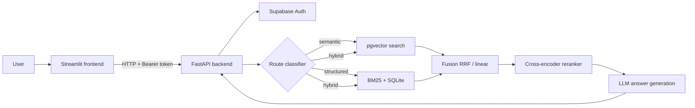

# Hybrid-RAG Document Intelligence

A multi-user question-answering system over your own documents. Each question is routed to the retrieval strategy that suits it (semantic search, structured keyword/SQL lookup, or both), the results are fused and reranked, and an LLM writes an answer grounded in the retrieved sources.

The system is split into a **FastAPI backend** (authentication, retrieval, ingestion, evaluation) and a thin **Streamlit frontend**, and runs with a single `docker compose up`.

## Features

- **Query routing.** A classifier decides whether a question needs semantic retrieval, structured lookup, or a hybrid of both, and reports its confidence and reasoning.
- **Hybrid retrieval.** Dense search over Supabase pgvector, BM25 keyword search (Elasticsearch, with an in-memory fallback) and a SQLite structured index, merged with Reciprocal Rank Fusion or linear fusion.
- **Cross-encoder reranking.** Candidates are reranked before the final chunks are passed to the LLM.
- **Grounded answers.** Every answer shows its route, latency, classifier confidence and the source chunks it came from.
- **Multi-user by design.** Supabase authentication, per-user document storage and retrieval, and a cap of 3 PDFs per user (the oldest is evicted automatically).
- **Multiple formats.** PDF, DOCX, TXT, HTML, CSV and XLSX, with several PDFs ingestible in one upload.
- **Built-in evaluation.** Run RAGAS and ROUGE-L metrics from the UI against your own CSV dataset, with per-route breakdowns, latency percentiles and downloadable JSON reports.
- **Traffic protection.** Per-user and per-IP rate limits, a per-user ingest lock, and caps on concurrent heavy jobs.

## Architecture



**Ingestion:** upload → parse (scraper) → chunk → embed → store in Supabase pgvector, with optional BM25 and SQLite indexing.

## Tech stack

| Layer | Technology |
|---|---|
| Frontend | Streamlit |
| Backend | FastAPI, Uvicorn, Pydantic |
| Auth and vector store | Supabase (Auth, Postgres, pgvector) |
| Embeddings | `BAAI/bge-large-en-v1.5` via sentence-transformers (OpenAI embeddings also supported) |
| Reranker | `BAAI/bge-reranker-large` cross-encoder (configurable) |
| Keyword and structured search | Elasticsearch BM25 (in-memory fallback), SQLite |
| LLM | Configurable provider and model (for example Groq) |
| Evaluation | RAGAS, ROUGE-L |
| Packaging | Docker, Docker Compose |

## Project structure

```
.
├── backend/                 FastAPI application
│   ├── main.py              app, startup (model loading), routers, /health
│   ├── config.py            environment and limits
│   ├── deps.py              token verification, admin check
│   ├── limits.py            rate limiting, locks, concurrency caps
│   ├── schemas.py           request and response models
│   └── routers/             auth, chat, documents, evaluation, admin
├── frontend/
│   ├── streamlit_app.py     UI (Chat, Ingest, Evaluation, Settings)
│   └── api_client.py        all HTTP calls to the backend
├── hybrid/                  routing, fusion, context building, generation
├── ingestion/               document scraper and chunker
├── vector_rag/              embeddings, Supabase vector store, retriever, reranker
├── vectorless_rag/          BM25 and SQL retrieval
├── classifier/              route classifier training and evaluation
├── evaluation/              RAGAS / ROUGE-L evaluator and saved reports
├── src/                     shared config and data models
├── Dockerfile
├── docker-compose.yml
├── start.sh                 single-container entrypoint
└── requirements.txt
```

## Quick start (Docker)

**Requirements:** Docker with at least 6 GB of memory available (the embedding model and reranker are held in RAM), a Supabase project, and an API key for your LLM provider.

1. Clone the repository.

2. Create a `.env` file in the project root:

   ```
   SUPABASE_URL=https://<project-ref>.supabase.co
   SUPABASE_SERVICE_ROLE_KEY=<service-role-key>
   SUPABASE_ANON_KEY=<anon-public-key>

   GROQ_API_KEY=<your-llm-provider-key>

   ADMIN_EMAILS=you@example.com
   ```

   Write values without quotes. Use the key variable that matches your configured LLM provider.

3. Set up the database (see below).

4. Build and start:

   ```bash
   docker compose up --build
   ```

5. Open the app at `http://localhost:8501`. The API docs are at `http://localhost:8000/docs`.

The first start downloads the embedding model and reranker (several GB) into a Docker volume and loads them into memory, so it takes a few minutes. Later starts reuse the cached models. The sidebar shows the pipeline status, and `GET /health` reports when the models are ready.

### Single container

The image can also run both services in one container, with Streamlit on port 7860 and the API kept internal:

```bash
docker build -t hybrid-rag .
docker run --rm -p 7860:7860 --env-file .env hybrid-rag
```

## Run without Docker

```bash
pip install -r requirements.txt
uvicorn backend.main:app --port 8000
streamlit run frontend/streamlit_app.py
```

Run both commands from the project root, in separate terminals. Use a single Uvicorn worker, because the in-memory BM25 index lives inside the process.

## Database setup

The code expects these objects in your Supabase project:

| Object | Purpose |
|---|---|
| `documents` table | One row per uploaded document: `user_id`, `doc_id`, `filename`, `filetype`, `source`, `created_at`, unique on `(user_id, doc_id)` |
| `chunks` table | One row per chunk: `user_id`, `doc_id`, `chunk_id`, `content`, `chunk_index`, `token_count`, `embedding` (pgvector), `metadata`, unique on `(user_id, chunk_id)`, with a foreign key to `documents` |
| `match_chunks` function | Cosine similarity search taking `query_embedding`, `match_user_id` and `match_count` |

The `embedding` column dimension must match your embedding model (1024 for `bge-large-en-v1.5`). Enable the `vector` extension and row-level security policies for both tables.

## Configuration

| Variable | Description |
|---|---|
| `SUPABASE_URL`, `SUPABASE_SERVICE_ROLE_KEY` | Required. The service-role key is used by the backend only and must never reach the frontend |
| `SUPABASE_ANON_KEY` | Used for login and signup (falls back to the service key if missing) |
| LLM provider key | For example `GROQ_API_KEY`, matching your configured provider |
| `ADMIN_EMAILS` | Comma-separated emails allowed to retrain the classifier. If empty, nobody can |
| `API_URL` | Frontend setting. Defaults to `http://localhost:8000` |
| `FRONTEND_ORIGINS` | Allowed CORS origins. Defaults to `http://localhost:8501` |
| `MAX_PDFS_PER_USER`, `MAX_UPLOAD_MB`, `MAX_FILES_PER_REQUEST` | Upload limits (defaults 3, 25, 10) |
| `MAX_CONCURRENT_INGEST`, `MAX_CONCURRENT_HEAVY` | Server-wide caps on simultaneous ingests and evaluation or training jobs (defaults 2 and 1) |

Model names, fusion settings, retrieval depth and classifier options are set in the application config under `src/`.

## API overview

| Method and path | Description |
|---|---|
| `POST /auth/signup`, `/auth/login`, `/auth/refresh`, `/auth/logout` | Account lifecycle. Login returns an access and a refresh token |
| `GET /auth/me` | Current user |
| `POST /chat/query` | Ask a question. Returns answer, route, confidence, reasoning, latency and source chunks |
| `GET /documents` | The user's library and index counts |
| `POST /documents/ingest` | Upload one or more files (multipart) |
| `DELETE /documents/{doc_id}` | Delete a document and its chunks |
| `POST /evaluation/run` | Run an evaluation from an uploaded CSV |
| `GET /evaluation/reports`, `/evaluation/reports/{name}` | List and download the user's saved reports |
| `GET /settings/config` | Active configuration (environment details for admins only) |
| `POST /settings/classifier/train`, `GET /settings/classifier/evaluate` | Admin only |
| `GET /health` | Model and pipeline readiness |

Every route except `/health`, signup, login and refresh requires an `Authorization: Bearer <token>` header. The user identity always comes from the verified token, never from the request body.

## Evaluation

Upload a CSV with the columns `query` and `reference`, and optionally `expected_route`, in the Evaluation tab. The run reports RAGAS and ROUGE-L metrics, routing accuracy, a per-route breakdown and latency percentiles (mean, p50, p95, p99). Use the ROUGE-L only option to run without any LLM calls. Reports can be saved as JSON and are only visible to the user who created them.

## Design notes and limitations

- **Models load once at startup** and are shared across requests. Loading them per request made a single query take minutes.
- **Heavy work is bounded.** Ingestion and evaluation run behind semaphores and per-user locks so concurrent users cannot exhaust the server, and an upload cannot push a user past the PDF limit.
- **Resource needs.** The two models need several GB of RAM, which is why the app is distributed as a Docker setup rather than hosted on a free tier.
- **Data isolation** relies on every query filtering by `user_id` in the backend, because the backend uses the service-role key. Adding a per-user database client would let row-level security enforce isolation as well.
- **Prompt injection.** Uploaded documents are passed to the LLM as context and could contain adversarial instructions. Treat retrieved text as untrusted and review the generation prompt before exposing the app publicly.
- **Single worker.** The in-memory BM25 index is per process, so run one Uvicorn worker, or move BM25 to Elasticsearch before scaling out.
